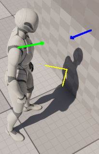
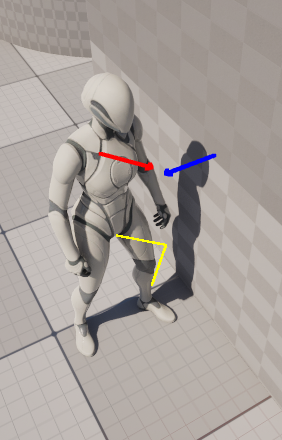
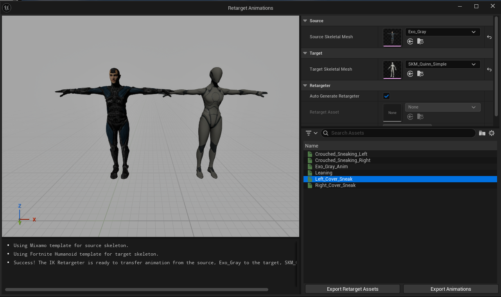
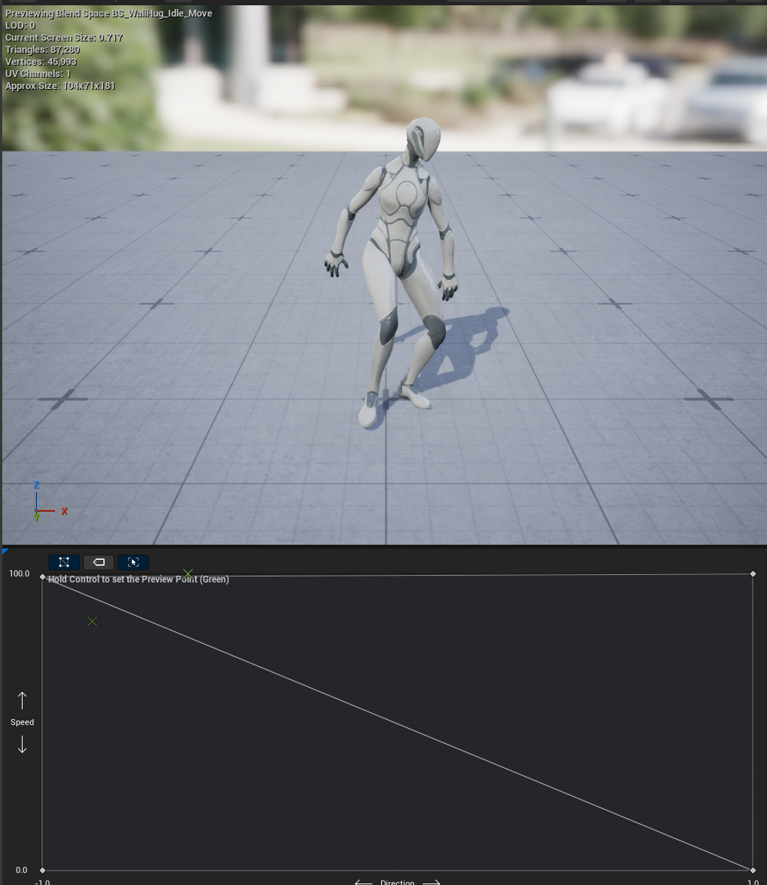
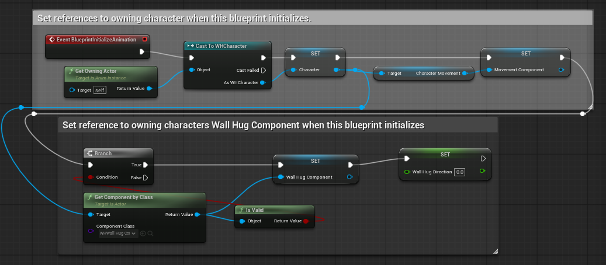
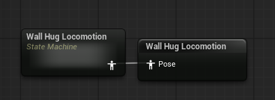
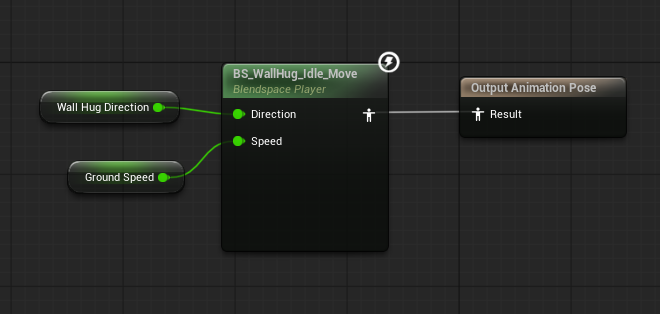
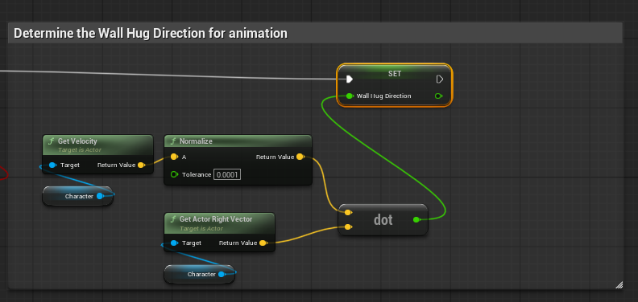
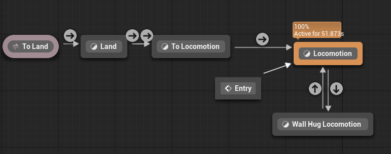
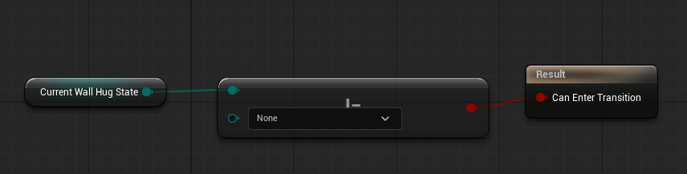

# Wall Hug Actor Component

A prototype for a wall hugging game mechanic on a 3rd person character controller. This has been implemented as a UActorComponent. The wall hug works by the player "pushing" the character into a wall and holding directional input (Metal Gear Solid style), as opposed to pressing a button to start and end the sequence. 

## Video:

## Summary

The guts of this mechanic lives inside the `UActorComponent`, `PWallHugComponent.h/cpp`.

To start the wall hug the player must approach a wall and "push" into it:
- Detect collision with obstacle using `OnComponentHit`.
- Determine if Character is facing the wall within the given tolerance - `PWallHugComponent::ApproachingWallTolerance`

  <figure style="display: inline-block; margin: 10px;">
    
    <figcaption><b>Inside ApproachingWallTolerance</b></figcaption>
  </figure>
  <figure style="display: inline-block; margin: 10px;">
    
    <figcaption><b>Outside of ApproachingWallTolerance</b></figcaption>
  </figure>

- Using the collision normal, create a rotation for the character to face away from the colliding obstacle.
- Calculate the perpendicular axis for "sliding" the character along the surface (`UWHWallHugComponent::ProcessBeginWallHug`).

Once the player is on the wall they must hold the directional input they used to start the wall hug and then use the perpendicular axis to slide the character along the wall. `UWHWallHugComponent::ProcessMovementInput` processes all the input handling whilst the player is on the wall:
- Determine if the player is still holding the starting input direction against the wall.
- Detect whether the player is pointing enough towards the current `UWHWallHugComponent::SlideAxis`.
- Inform the character of any movement (`APawn::AddMovementInput`) according to the above. 

During the wall hug, a capsule sweep is performed behind the player to ensure they are still against an obstacle (`UWHWallHugComponent::ProcessOnWallState`). Several variables are also recalculated including: 
- The target rotation for the character for keeping their back to the surface.
- The perpendicular of the surface being hugged. This is used for sliding the player correctly across the surface. 

`UWHWallHugComponent` sets a publicly accessible state, `EWallHugState`, which can be accessed by C++ and Blueprints. `UWHWallHugComponent` utilises the current state to switch the current processing logic it needs to run for the mechanic. The animation system utilises the component `EWallHugState` for driving the current locomotion state logic. 

The animations are from Mixamo (see below for references or just grab from the project). They are retargeted to Unreal Quinn using the Retarget Animations tool (right click on src animation and search for  “Retarget Animations”).

    

A 2D Blendspace is used for the slide animation. The x-axis controls direction whilst the y-axis controls the speed. The animations are blended between Left cover sneak, Leaning and Right cover sneak.

    

The animation and locomotion is controlled via the characters Animation Blueprint. The Animation Blueprint uses the Wall Hug Component for understanding the current state of the wall hug (`UWHWallHugComponent::GetState`). 

   <figure style="display: inline-block; margin: 10px;">
    
    <figcaption><b>Acquiring Wall Hug Component</b></figcaption>
  </figure>

The characters Animation Blueprint has been adapted for an additional State and Pose for the Wallhug Locomotion: 

    

The wall hug locomotion is a Blendspace player, utilising the 2D Blendpsace above: 

    

The Ground Speed comes from the Character Movement component (setup in ABP_Unaramed by default), and the Wall Hug Direction is calculated from the Actors right vector and current velocity within the Event Graph.

   <figure style="display: inline-block; margin: 10px;">
    
    <figcaption><b>Calculating wall hug direction</b></figcaption>
  </figure>

The Wallhug Locomotion pose is plugged into the rest of the AnimGraph.

    

The state transitions assess the Wall Hug Components current `EWallHugState`, moving into the Wall Hug locomotion when `state != ENone` and out when `state == ENone`.

    

## Mixamo animations: 
- [Left cover sneak](https://www.mixamo.com/#/?page=1&query=Left+cover+sneak)
- [Right cover sneak](https://www.mixamo.com/#/?page=1&query=Right+cover+sneak)
- [Leaning](https://www.mixamo.com/#/?page=1&query=leaning)
## Remarks/TODOs:
- Explore the use of IK to correct animation and wall contact points. 
- Crouching wall hug state.
## Licence

Copyright (c) 2026 Daniel Weston

Permission is hereby granted, free of charge, to any person obtaining a copy
of this software and associated documentation files (the "Software"), to deal
in the Software without restriction, including without limitation the rights
to use, copy, modify, merge, publish, distribute, sublicense, and/or sell
copies of the Software, and to permit persons to whom the Software is
furnished to do so, subject to the following conditions:

The above copyright notice and this permission notice shall be included in all
copies or substantial portions of the Software.

THE SOFTWARE IS PROVIDED "AS IS", WITHOUT WARRANTY OF ANY KIND, EXPRESS OR
IMPLIED, INCLUDING BUT NOT LIMITED TO THE WARRANTIES OF MERCHANTABILITY,
FITNESS FOR A PARTICULAR PURPOSE AND NONINFRINGEMENT. IN NO EVENT SHALL THE
AUTHORS OR COPYRIGHT HOLDERS BE LIABLE FOR ANY CLAIM, DAMAGES OR OTHER
LIABILITY, WHETHER IN AN ACTION OF CONTRACT, TORT OR OTHERWISE, ARISING FROM,
OUT OF OR IN CONNECTION WITH THE SOFTWARE OR THE USE OR OTHER DEALINGS IN THE
SOFTWARE.
